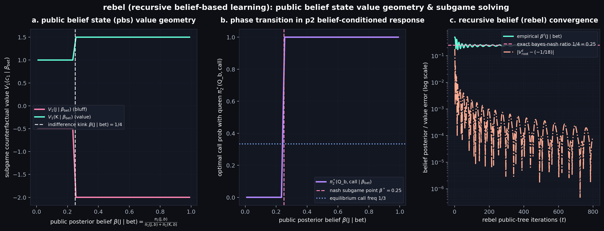
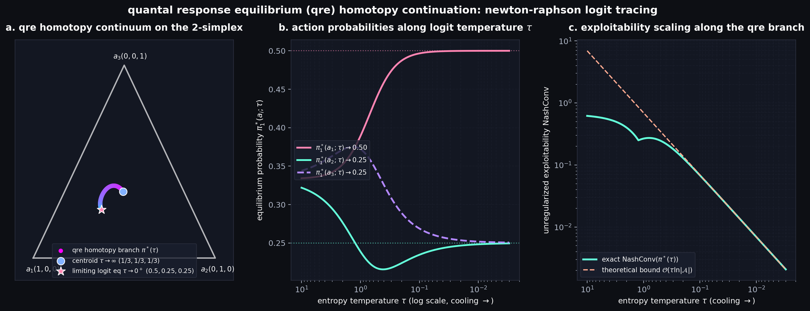
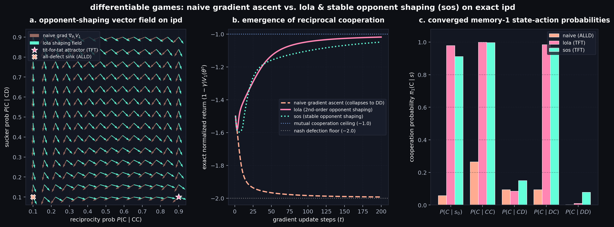

# ml-rl-minis

This repository is currently under progress—a surgical lab of from-scratch reinforcement learning and game-theoretic primitives. Everything here is built around exact mechanism verification, analytical invariant checks, and dark-mode phase portraits.

There are two main categories of projects:
1. **Tutorials** — multi-file deep dives housed in their own dedicated folders.
2. **Single-file projects** — self-contained, zero-fluff scripts in the root directory that implement and verify a specific algorithm from first principles.

---

# Gallery

### 1. Recursive Belief-Based Learning (ReBeL) & Public Belief States

Converts an imperfect-information extensive-form game into a continuous-state perfect-information game over the **Public Belief State (PBS)** simplex. Conditioning subgame solving on public posterior reach probabilities $\beta(c_i \mid h_{\text{pub}})$ maps out the exact piecewise-linear convex counterfactual value surface, verifying the indifference kink at $\beta^\star(\text{J} \mid \text{bet}) = \frac{1}{4}$ and the exact minimax root value $v^\star = -\frac{1}{18}$.

$$
\pi_{i}^{\star}(a \mid \tau) = \frac{\exp\left(Q_{i}^{\pi^{\star}}(a) / \tau\right)}{\sum_{a' \in \mathcal{A}_{i}} \exp\left(Q_{i}^{\pi^{\star}}(a') / \tau\right)}
$$

---

### 2. Quantal Response Equilibrium (QRE) Homotopy & Logit Tracing

Traces the smooth Quantal Response Equilibrium continuum from the high-entropy uniform centroid ($\tau \to \infty$) down to the unique **Limiting Logit Equilibrium** ($\tau \to 0^+$) on the 2-simplex via damped Newton-Raphson predictor-corrector continuation. Verifies the theoretical exploitability scaling bound $\text{NashConv}(\pi^*(\tau)) = \mathcal{O}(\tau \ln |\mathcal{A}|)$ along the entire logit branch.

$$
\pi_{i}^{\star}(a \mid \tau) = \frac{\exp\left(Q_{i}^{\pi^{\star}}(a) / \tau\right)}{\sum_{a' \in \mathcal{A}_{i}} \exp\left(Q_{i}^{\pi^{\star}}(a') / \tau\right)}
$$

---

### 3. Differentiable Games: LOLA & Stable Opponent Shaping (SOS)

Solves the exact 5-state Markov representation of the Iterated Prisoner's Dilemma (IPD) analytically via the resolvent $\mathbf{M} = (\mathbf{I} - \gamma \mathbf{P})^{-1}$—zero finite-difference hacks or rollout variance. While naive gradient ascent marches straight into the mutual defection sink (`ALLD`, $V = -2.0$), differentiating through the opponent's learning step via **LOLA** and **SOS** bends the vector field into the reciprocal **Tit-for-Tat (`TFT`)** attractor ($V \to -1.0$).

$$
\Delta \theta_1^{\text{LOLA}} = \nabla_{\theta_1} V_1 + \delta \left( \nabla_{\theta_1 \theta_2}^2 V_2 \right)^\top \nabla_{\theta_2} V_1
$$
