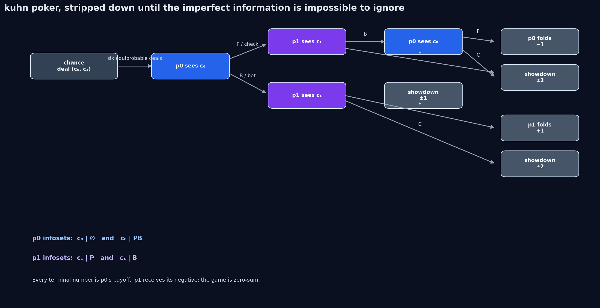
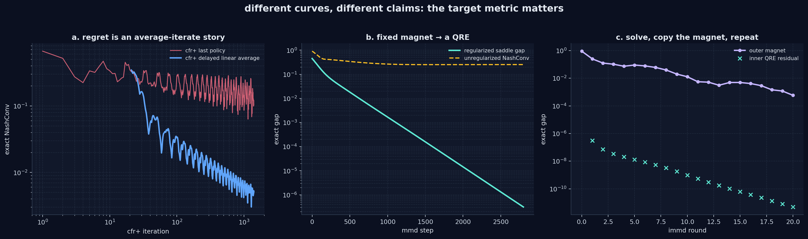
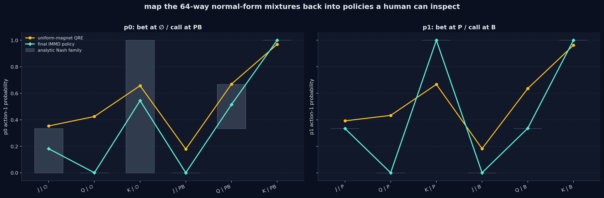

# devlog: iterative magnetic mirror descent in kuhn poker

a two-player game can be tiny enough to fit in one file and still punish sloppy language. kuhn poker has three cards, two actions at a time, and exactly enough hidden information to make “my policy seems stable” a dangerously vague sentence.

1. CFR+ reduces regret; its averaged policy is the object with the classical equilibrium guarantee.
2. Fixed-magnet magnetic mirror descent (MMD) converges to a **regularized** equilibrium, a quantal-response equilibrium (QRE), so its ordinary exploitability is intentionally not zero.
3. Iterative MMD (IMMD) keeps that robust inner problem but refines the reference policy between fully solved rounds. This is the small, tabular ancestor of the current NashPG line of work.

No fake R-NaD label has been smuggled in here. That would be a very expensive way of being technically wrong.



## what is in this folder

| file | job |
| --- | --- |
| [kuhn_immd_lab.py](kuhn_immd_lab.py) | exact game construction, CFR+, fixed-magnet MMD, IMMD, assertions, and figure generation |
| [kuhn_immd_tree.png](kuhn_immd_tree.png) | the imperfect-information game tree |
| [kuhn_immd_dynamics.png](kuhn_immd_dynamics.png) | average-iterate CFR+, QRE convergence, and iterative magnet refinement |
| [kuhn_immd_policies.png](kuhn_immd_policies.png) | normal-form mixtures mapped back to readable behavioural policies |

The project is deliberately flat: one Python file, this README, and adjacent generated PNGs. Nothing has been trained on a random seed or hidden behind an opaque environment wrapper; every quantity in the plots is exact for this finite game.

## run it

Install only NumPy and Matplotlib, then execute the file from this folder.

~~~bash
python -m pip install numpy matplotlib
python kuhn_immd_lab.py
~~~

### run it in google colab

Create a blank Colab notebook, run this cell, select the delivered kuhn_immd_lab.py when the uploader opens, then Colab will generate and download the three figures.

~~~python
!pip -q install numpy matplotlib
from google.colab import files

files.upload()
!python kuhn_immd_lab.py

for name in (
    "kuhn_immd_tree.png",
    "kuhn_immd_dynamics.png",
    "kuhn_immd_policies.png",
):
    files.download(name)
~~~

The script recreates all three PNGs beside itself and prints three useful end-state diagnostics:

- CFR+ average-policy NashConv;
- the fixed-magnet QRE residual;
- IMMD's unregularized NashConv.

The default run uses a deterministic full-tree / full-matrix calculation. It should not need a seed because it has no sampling in the learning loop.



## the game: six little deals and a surprising amount of strategy

Chance deals two distinct cards from $ \{J,Q,K\} $ , so there are six equiprobable ordered deals. Player 0 sees $c_0$, acts first, and player 1 sees only $c_1$.

- $P$: pass / check
- $B$: bet
- $F$: fold
- $C$: call

If both players check, the higher card wins $+1$ for player 0. A fold pays $+1$ to the bettor. A called bet reaches showdown for $\pm 2$. Player 1 always receives the negative of player 0's payoff, so this is a two-player zero-sum extensive-form game with perfect recall.

There are six binary information sets per player:

```math
\begin{aligned}
\mathcal I_0 &= \{J|\varnothing,Q|\varnothing,K|\varnothing,
                   J|PB,Q|PB,K|PB\},\\
\mathcal I_1 &= \{J|P,Q|P,K|P,J|B,Q|B,K|B\}.
\end{aligned}
```

The first three for player 0 mean “my card at the root.” The latter three mean “my card after I checked and faced a bet.” Same idea for player 1, with $P$ and $B$ telling them what they observed. The opponent's card never appears in an information-set label. That missing variable is the whole point.

## ground truth before algorithms

Kuhn poker is friendly because it has a known value and a continuum of Nash equilibria. From player 0's view,

```math
v^\star=-\frac{1}{18}.
```

A convenient equilibrium family is indexed by $\alpha\in[0,\frac13]$. The table records the probability of action 1, where action 1 is bet at a root/check node and call at a response node.

| player / information set | action-1 probability |
| --- | --- |
| p0: $J\mid \varnothing$ | $\alpha$ |
| p0: $Q\mid \varnothing$ | $0$ |
| p0: $K\mid \varnothing$ | $3\alpha$ |
| p0: $J\mid PB$ | $0$ |
| p0: $Q\mid PB$ | $\frac13+\alpha$ |
| p0: $K\mid PB$ | $1$ |
| p1: $J\mid P$ | $\frac13$ |
| p1: $Q\mid P$ | $0$ |
| p1: $K\mid P$ | $1$ |
| p1: $J\mid B$ | $0$ |
| p1: $Q\mid B$ | $\frac13$ |
| p1: $K\mid B$ | $1$ |

This matters for more than a cute unit test. The equilibrium is not a single policy. Any claim that an optimizer “discovers the one true policy” is already confused; the method's geometry, reference policy, and implementation choices decide where it lands along or near that set.

The code verifies four points of this family, including both endpoints, against the exact value and exact NashConv.

## why normal form here, of all places?

A deterministic policy selects one binary action at each of six information sets. Therefore each player has

```math
2^6=64
```

pure strategies. Enumerating them produces an exact payoff matrix

```math
A\in\mathbb R^{64\times64},\qquad
A_{ij}=\mathbb E[u_0\mid s_0=i,s_1=j].
```

Let $x,y\in\Delta^{63}$ be distributions over the 64 pure strategies. The row player maximizes and the column player minimizes

```math
u(x,y)=x^\top A y.
```

This is intentionally not a scalable representation. In a large extensive-form game it is exponentially bad, and one should use sequence form with dilated entropy, or a sampled policy-gradient method. But for Kuhn poker, normal form buys something genuinely valuable: every update, best response, QRE residual, and NashConv is exact and short enough to audit without thy brain falling into a recursive abyss.

The script also maps a normal-form mixture back to a behavioral policy. At player 0's later $PB$ information sets, it conditions on that pure policy having checked at the matching root information set. That conditioning is necessary: it preserves the realization-equivalent policy rather than pretending that a correlated normal-form mixture is automatically independent everywhere.

## exploitability: the metric that does not let us lie politely

For a zero-sum matrix game, the exact NashConv is

```math
\mathrm{NashConv}(x,y)
=
\max_i (Ay)_i-\min_j(x^\top A)_j.
```

The first term is player 0's best-response value against $y$; the second is the value player 1 can force against $x$. It is non-negative and becomes zero at a Nash equilibrium. There are no learned best-response networks, no rollouts, and no “looks approximately blue enough” metric in this file.

For behavioral policies, the code first creates their realization-equivalent independent normal-form distributions, then applies this same exact matrix calculation. As a second check, four fixed-seed random behavioral policy pairs are evaluated two ways:

```math
x^\top A y
\quad\text{and}\quad
\sum_{c_0\ne c_1}\frac16\,u_0(\sigma_0,\sigma_1;c_0,c_1).
```

They must agree to numerical precision.

## cfr+: useful foil, not the villain

Counterfactual regret minimization decomposes a global game into local regret minimizers. At each information set $I$, CFR+ maintains non-negative cumulative regrets

```math
R_t^+(I,a)
=
\max\left\{0,\,
R_{t-1}^+(I,a)
+
v_i^{\sigma_t}(I,a)
-
v_i^{\sigma_t}(I)
\right\}.
```

The next local policy is regret matching on these positive values:

```math
\sigma_{t+1}(a\mid I)
=
\begin{cases}
\dfrac{R_t^+(I,a)}{\sum_b R_t^+(I,b)}, & \sum_b R_t^+(I,b)>0,\\[8pt]
\dfrac1{|A(I)|}, & \text{otherwise.}
\end{cases}
```

The implementation traverses all six chance deals, holds the policy fixed through an iteration, accumulates counterfactual updates, clips after the sweep, and forms a delayed linearly weighted average policy. The chance factor is included in every counterfactual update. The average policy uses the acting player's reach probability; common chance factors cancel only after they have been applied consistently.

The important distinction: ordinary CFR theory is an **average-iterate** result. CFR+ often has pleasant current-policy behaviour in practice, but that is not the same theorem. The left panel is intentionally labelled “CFR+ last policy” and “CFR+ linear average,” not “CFR+ fails forever” or some other dramatic nonsense.

## fixed-magnet mmd: a QRE solver

Let $\rho_0,\rho_1$ be strictly positive reference distributions — the magnets — and let $\tau>0$. Define the regularized saddle objective

```math
L_\tau(x,y;\rho)
=
x^\top A y
-\tau D_{\mathrm{KL}}(x\Vert\rho_0)
+\tau D_{\mathrm{KL}}(y\Vert\rho_1).
```

The row player maximizes it and the column player minimizes it. The KL divergence is

```math
D_{\mathrm{KL}}(p\Vert q)
=
\sum_i p_i\log\frac{p_i}{q_i}.
```

The signs are not decorative. The row player is penalized for leaving its magnet; the column player, because it minimizes, is also penalized for leaving its magnet. With a fixed positive $\tau$, the game is strongly regularized and its QRE is unique in the interior.

Using negative entropy as the mirror map, the simultaneous KL-prox update in the script is

```math
x_{t+1}
=
\mathrm{softmax}
\left(
\frac{\log x_t+\eta Ay_t+\eta\tau\log\rho_0}
{1+\eta\tau}
\right),
```

```math
y_{t+1}
=
\mathrm{softmax}
\left(
\frac{\log y_t-\eta A^\top x_t+\eta\tau\log\rho_1}
{1+\eta\tau}
\right).
```

Componentwise, the row update can be written as

```math
x_{t+1,i}
\propto
\left[
x_{t,i}\,
\rho_{0,i}^{\eta\tau}\,
\exp\!\left(\eta(Ay_t)_i\right)
\right]^{\frac{1}{1+\eta\tau}},
```

with the analogous negative-payoff expression for the column player. This is exactly what fixed_mmd does; there is no hidden reward shaping, no policy network, and no tempering schedule pretending to be a convergence proof.

### the right fixed-magnet diagnostic

A QRE is not generally a Nash equilibrium of the unregularized game. Its ordinary NashConv can therefore settle above zero by design. The middle panel plots the regularized saddle gap

```math
G_\tau(x,y;\rho)
=
\max_{x'}L_\tau(x',y;\rho)
-
\min_{y'}L_\tau(x,y';\rho)
\ge 0,
```

alongside ordinary NashConv specifically so they cannot be mistaken for the same objective.

For this entropy-regularized matrix game, each best-response part of $G_\tau$ has a closed form using log-sum-exp. That is why the code can measure it exactly rather than estimate it with an optimizer. Hark: a small residual only means the fixed-magnet QRE has been solved well. It does **not** mean a Nash equilibrium has appeared by divine intervention.

## immd: keep the regularizer, move the magnet

Annealing $\tau$ toward zero changes the problem every step. It can be a useful continuation heuristic, but it does not inherit a fixed - $\tau$ convergence theorem just because the curve is aesthetically pleasing.

IMMD takes a cleaner route. At outer round $r$, it approximately solves the fixed-magnet inner game, checks its residual, then copies that solution into the next magnet:

```math
x_r \in \arg\max_x L_\tau(x,y_r;\rho^r),
\qquad
y_r \in \arg\min_y L_\tau(x_r,y;\rho^r),
\qquad
\rho^{r+1}=(x_r,y_r).
```

The regularization strength stays fixed. In the theory-faithful idealization, the inner problem is solved exactly. This implementation uses 2,800 full-information MMD steps per round and reports the final inner regularized gap, so the finite-inner approximation is visible rather than magically hand-waved away.

The right panel plots two separate things:

- purple: unregularized NashConv of the **outer** magnet;
- mint crosses: the residual left by each **inner** QRE solve.

NashConv need not decrease monotonically round by round, even though the underlying refinement theory tracks a Bregman-distance quantity. The target is the downward trend toward the Nash set, not a dishonest claim that every plotted metric must behave monotonically.



## how to read the policy plot

The grey band is the analytical Nash family from the table above. Gold is a fixed uniform-magnet QRE. Mint is the final IMMD policy, translated back from its 64-way normal-form mixture to behavior at the six actual information sets.

Two things should be visible:

1. the fixed QRE is deliberately smoother and may lie outside the unregularized Nash band;
2. iterative magnet refinement brings the interpretable behavioral probabilities into the Nash family as its exact NashConv becomes small.

This is not an information projection plot. Normal-form entropy, behavioral entropy, and sequence-form dilated entropy are different geometries. Reusing the often-quoted “maximum-entropy Kuhn equilibrium” story here without implementing its matching regularizer would be wrong, so it is deliberately not claimed.

## verification ledger

Running the script executes these checks before it writes a figure:

* all $64 \times 64$ pure-policy payoffs use the six legal ordered deals and correct terminal stakes;
* four known analytical equilibria have value $-1 / 18$ and machine-zero NashConv;
* normal-form evaluation matches direct behavioral-tree evaluation on four random policy pairs;
* MMD distributions remain normalized and all monitored gaps remain finite;
* the default render configuration is gated by $G_{\tau} < 10^{-5}$, a final inner residual below $10^{-8}$, and IMMD NashConv below $10^{-3}$.

The generated run then exposes, rather than hides, the important numerical state: CFR+ average NashConv, fixed-QRE residual, and final IMMD NashConv. No run needs to be trusted merely because it made a nice chart.


The generated run then exposes, rather than hides, the important numerical state: CFR+ average NashConv, fixed-QRE residual, and final IMMD NashConv. No run needs to be trusted merely because it made a nice chart.

## what this does **not** claim

- It is **not** a DeepNash or R-NaD reimplementation. R-NaD uses a specific frozen-reference reward transformation and a deep/self-play inner-learning procedure; swapping in one local KL update would not make it R-NaD.
- It is **not** a deep-RL benchmark. There is no neural network, replay buffer, rollout noise, or “beats baseline after 17 seeds” headline.
- It is **not** a scalable extensive-form solver. Normal form grows exponentially; this is chosen here to make the mathematics inspectable.
- It does **not** establish a universal last-iterate claim for every MARL algorithm. It cleanly distinguishes a fixed QRE target from an iteratively refined Nash target.

That restraint is the mini's selling point. It gives you a reproducible, mathematically audited visual before the larger sequence-form, policy-gradient, or partially observable extensions enter with their own dragons.

## where this sits in the current line of work

Magnetic mirror descent gave a clean fixed-reference, regularized route to last-iterate convergence in two-player zero-sum games. NashPG's iterative reference refinement is a very current development: it keeps regularization non-vanishing during inner learning and proves convergence of the refinement process to an exact Nash equilibrium in the two-player zero-sum setting.

So the next sensible mini after this is not “add more knobs until a curve goes down.” A strong continuation would be a small sequence-form/dilated-entropy version, or a three-player DRDA toy POSG where the nice two-player zero-sum guarantees genuinely become more delicate.

## sources

- Sokota et al., [A Unified Approach to Reinforcement Learning, Quantal Response Equilibria, and Two-Player Zero-Sum Games](https://arxiv.org/abs/2206.05825), ICLR 2023.
- Yu et al., [Nash Policy Gradient: A Policy Gradient Method with Iteratively Refined Regularization for Finding Nash Equilibria](https://arxiv.org/abs/2510.18183), 2026 work in progress / preprint.
- Tammelin, [Solving Large Imperfect Information Games Using CFR+](https://arxiv.org/abs/1407.5042), 2014.
- Pérolat et al., [Mastering the Game of Stratego with Model-Free Multiagent Reinforcement Learning](https://arxiv.org/abs/2206.15378), for the R-NaD / DeepNash lineage this mini explicitly does not impersonate.

